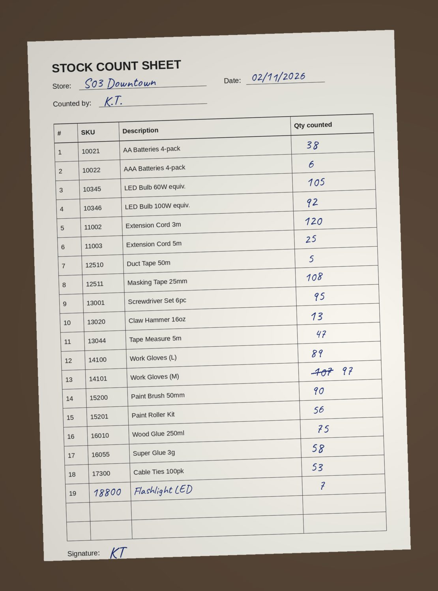
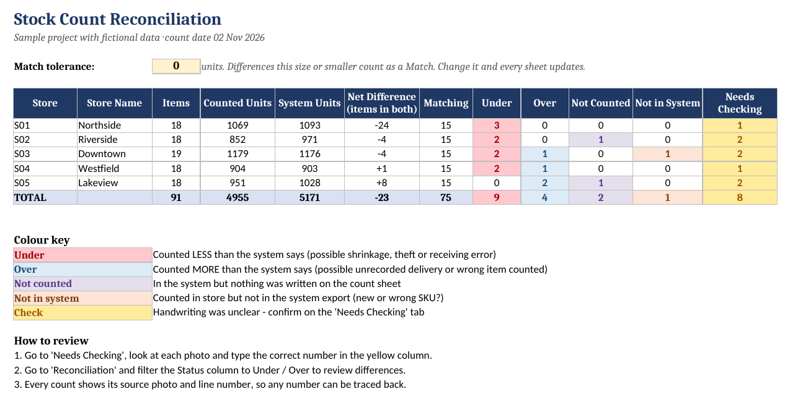
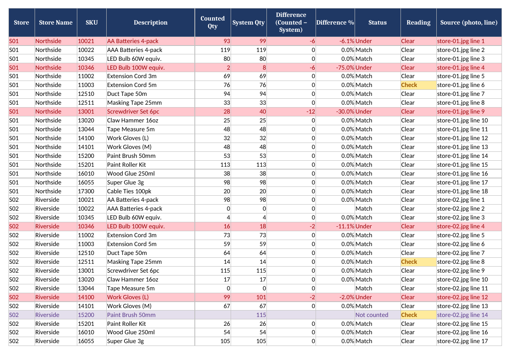
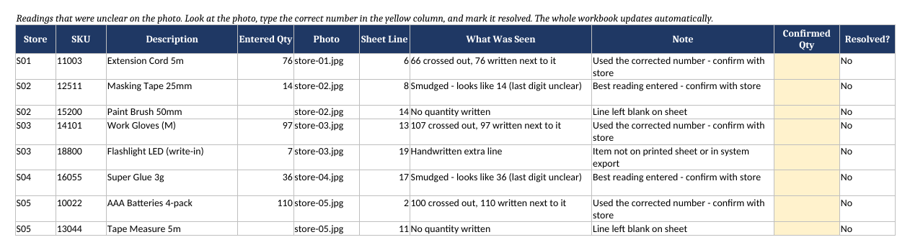

# Stock Count Reconciliation (Sample Project)

This project turns photos of handwritten stock count sheets into a clean Excel workbook. It compares every count with the stock system's export and highlights each difference so it can be reviewed.

> **All data here is fictional.** The 5 stores, the items and every number were made up for this demo.

**Download the result:** [`output/Stock_Count_Reconciliation.xlsx`](output/Stock_Count_Reconciliation.xlsx)

## The problem
Staff counted stock in several stores and sent phone photos of their paper count sheets. The business needs:
1. every count entered accurately into a master Excel file,
2. the counts compared with what the stock system says should be on hand, and
3. the differences clearly highlighted for review.

**Input: a photo of a count sheet**



## The result

**Summary:** totals per store, with problem counts highlighted. The yellow tolerance cell controls what counts as a match.



**Reconciliation:** every item in every store, colour-coded by status, with the source photo and line number.



**Needs Checking:** readings that were unclear on the photo. The reviewer types the confirmed number in the yellow column and the whole workbook updates.



## How accuracy is protected
| Risk | What the workbook does |
|---|---|
| Rows matched wrongly | Items are matched on **store + SKU**, never on product name |
| A number can't be traced | Every count keeps its **photo file and sheet line number** |
| Messy handwriting is guessed | Unclear readings are **flagged as "Check"**, never silently guessed |
| Crossed-out numbers | The corrected number is used and **flagged for confirmation** |
| Blank lines on a sheet | Shown as **"Not counted"**, not as zero |
| Items written in by hand | Shown as **"Not in system"**, so they can't disappear |
| Hidden calculation errors | All comparisons are **live Excel formulas**, so anyone can see how a number was worked out |

## Statuses and colours
| Status | Meaning |
|---|---|
| Under (red) | Counted less than the system says |
| Over (blue) | Counted more than the system says |
| Not counted (purple) | In the system, but nothing was written on the sheet |
| Not in system (orange) | Counted, but missing from the system export |
| Check (yellow) | Handwriting was unclear and needs confirming |

## Workbook tabs
- **Summary**: per-store totals, the match tolerance setting, a colour key and review steps
- **Reconciliation**: one row per store and item, with counted vs system quantities, difference and status
- **Counts (Entered)**: the data entered from the photos, with source and reading quality
- **Needs Checking**: unclear readings for the reviewer to confirm
- **System Export**: the stock system data, unchanged

## Testing
The workbook was recalculated in LibreOffice, and every formula result was checked against a separate Python calculation. All 91 rows matched and no cell showed an error. Changing the tolerance and entering confirmed quantities were also tested, and the changes flowed through every tab correctly.

## Recreate it yourself
Requires Python 3 with `openpyxl` and `Pillow`.
```bash
pip install openpyxl pillow
python3 scripts/generate_sample_data.py   # makes the fictional photos and system export
python3 scripts/build_reconciliation.py   # builds output/Stock_Count_Reconciliation.xlsx
```
To use your own data, replace `input/entered_counts.csv` and `input/system_export.xlsx` (same columns), then run the second command.

## Project structure
```
input/count_sheet_photos/   photos of the count sheets (fictional)
input/entered_counts.csv    counts entered from the photos
input/system_export.xlsx    stock system export (fictional)
output/                     the finished reconciliation workbook
scripts/                    Python scripts that generate the sample data and build the workbook
docs/                       screenshots for this README
```

The handwriting font is [Caveat](https://github.com/googlefonts/caveat) (SIL Open Font License, see `assets/fonts/`).
